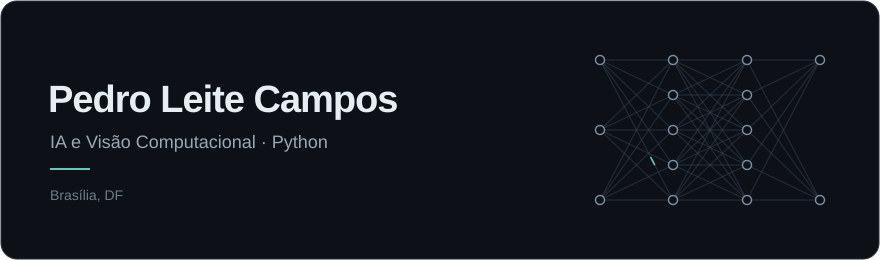
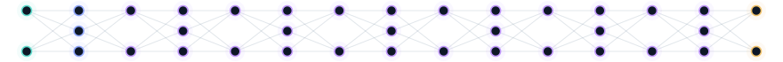

<p align="center">
  
</p>

<p align="center">
  <a href="https://plc232007.github.io/portifolio-pedro/"></a>
  <a href="https://www.linkedin.com/in/pedro-campos-1473a5345/"></a>
  <a href="https://plc232007.github.io/portifolio-pedro/assets/docs/curriculo-pedro-leite-campos.pdf"></a>
  <a href="mailto:pleitecampos@gmail.com"></a>
</p>

<p align="center">
  <b>Ensino máquinas a enxergar — e construo o software que leva o modelo até quem usa.</b><br>
  <sub>🟢 Aberto a oportunidades em <b>IA e visão computacional</b> · Brasília, DF</sub>
</p>



### 🧠 `forward()` — quem está do outro lado da rede

```python
class Pedro(nn.Module):
    """Estagiário de IA · Ciência da Computação no IESB (2025–2028) · Brasília, DF"""

    foco_atual = ["visão computacional", "detecção de objetos", "deep learning"]
    treinando  = {"modelos": "YOLO", "framework": "PyTorch", "imagens": "OpenCV", "dados": ["Pandas", "NumPy"]}
    base       = ["fullstack (React · Next.js · Flask · FastAPI)", "requisitos", "SQL"]

    def forward(self, problema):
        requisito = self.entender(problema)          # comecei como analista de requisitos
        modelo    = self.treinar(requisito)          # hoje: visão computacional na CNT
        return self.colocar_em_uso(modelo)           # API, banco e interface em volta do modelo
```

Hoje sou **estagiário de IA e Visão Computacional na CNT**, aplicando visão computacional à **Pesquisa CNT de Rodovias**, que avalia as condições das rodovias brasileiras. Treino e avalio modelos **YOLO em PyTorch**, comparo métricas entre experimentos, preparo dados com **Pandas e NumPy**, processo imagens com **OpenCV** e documento os resultados para a equipe.

Antes, fui **analista de requisitos** e depois **desenvolvedor fullstack** na Engesoftware. É essa combinação que eu trago: entender o problema, treinar o modelo e construir o que fica em volta dele.

### 🔬 Do pixel ao produto

<p align="center">
  
</p>

| Camada | O que eu faço ali |
|---|---|
| **Dados** | Organizo e analiso o que entra no modelo — o resultado começa aqui. |
| **Pré-processo** | Trato imagens com OpenCV e dados tabulares com Pandas e NumPy. |
| **Treino** | Treino detectores YOLO em PyTorch e registro cada experimento. |
| **Avaliação** | Comparo métricas entre experimentos e levo o que elas revelam de volta para os dados. |
| **Produto** | Uso a base fullstack para transformar o modelo em API, banco e interface. |


### 🛰️ Trajetória

| Período | Papel | Onde | Stack |
|---|---|---|---|
| **09/2026 → hoje** | Estagiário em IA e Visão Computacional | CNT · Pesquisa CNT de Rodovias | `Python` `PyTorch` `YOLO` `OpenCV` `Pandas` `NumPy` |
| 10/2025 → 10/2026 | Desenvolvedor Fullstack (estágio) | Engesoftware Tecnologia | `Python` `Flask` `TypeScript` `Git` |
| 04/2025 → 10/2025 | Analista de Requisitos (estágio) | Engesoftware Tecnologia | `Jira` `Figma` `Kanban` |
| 2025 → 2028 | Bacharelado em Ciência da Computação | Centro Universitário IESB | — |

<details>
<summary><b>Ver detalhes da experiência</b></summary>

<br>

**CNT · Estagiário em IA e Visão Computacional**
- Aplico visão computacional à Pesquisa CNT de Rodovias.
- Treino e avalio modelos YOLO em PyTorch, comparando métricas entre experimentos.
- Preparo e analiso dados com Pandas e NumPy e processo imagens com OpenCV.
- Documento experimentos e resultados para a equipe.

**Engesoftware · Desenvolvedor Fullstack**
- Interfaces web com JavaScript, TypeScript e HTML/CSS em ciclos semanais de entrega.
- Endpoints REST em Python e Flask integrados a banco de dados relacional.
- Repositórios colaborativos com Git, branches e code review.

**Engesoftware · Analista de Requisitos**
- Requisitos de mais de 20 funcionalidades levantados e documentados em sprints quinzenais.
- Regras de negócio traduzidas em especificações consumidas por 3 times de desenvolvimento.
- Protótipos de 4 módulos no Figma, reduzindo retrabalho no front-end.

Também desenvolvo sites e sistemas para clientes reais pela **[Leite Campos Consultoria](https://plc232007.github.io/leite-campos/)**, empresa da minha família.

</details>


### 🚀 Projetos

#### 🤖 IA aplicada

**[FactoryFlow AI](https://github.com/plc232007/factoryflow-ai)** · pipeline multiagente
Recebe um requisito em linguagem natural e gera análise, arquitetura, código Python, testes e relatório — cada etapa é um agente.
`Python` `OpenAI Agents SDK` `pytest`

**[LVM — Laboratório Virtual de Matemática](https://github.com/plc232007/lvm)** · [abrir app ↗](https://lvm-seven.vercel.app)
Laboratório interativo de geometria para um TCC do IFB. O **Fermat**, um assistente com LLM, tira dúvidas no contexto da atividade sem entregar a resposta; ele roda no servidor, então a chave da API nunca chega ao navegador. Exercícios gerados por semente e cobertos por testes de propriedade.
`Next.js 16` `React 19` `TypeScript` `LLM` `Vitest` `fast-check`

**[Anime Finance](https://github.com/plc232007/anime-finance)** · em evolução
Finanças pessoais fullstack com um módulo de IA que analisa hábitos de gasto.
`Django REST` `JWT` `React` `pytest`

#### 🧩 Produtos em uso

**[App dos Catequistas](https://github.com/plc232007/app-catequese)** · [abrir app ↗](https://app-catequese-taupe.vercel.app)
Biblioteca de materiais, mural e calendário para cerca de **70 catequistas**, com permissões por **Row Level Security** no PostgreSQL.
`React` `Vite` `Supabase` `PostgreSQL` `Tailwind`

**[Organizador de Contas](https://github.com/plc232007/organizador-contas)** · [abrir app ↗](https://organizador-contas-et4n.vercel.app/)
PWA instalável para as finanças da família, com isolamento de dados por usuário, validação com Zod e migrations versionadas.
`Next.js 16` `Supabase` `Zod` `shadcn/ui` `PWA`

<details>
<summary><b>🧪 Outras bancadas do laboratório · mais 6 projetos</b></summary>

<br>

- **[Task Manager API](https://github.com/plc232007/to-do-list)** — API REST de tarefas com FastAPI, SQLAlchemy e Pydantic
- **[Sabor Express](https://github.com/plc232007/sabor-express)** · [ver](https://sabor-express-eight.vercel.app/) — uma camada de regras, duas interfaces (terminal e Flask)
- **[Catálogo Naty](https://github.com/plc232007/catalogo-naty)** · [ver](https://catalogo-naty.vercel.app/) — vitrine e estoque para uma empreendedora real
- **[Leite Campos Consultoria](https://github.com/plc232007/leite-campos)** · [ver](https://plc232007.github.io/leite-campos/) — site institucional da consultoria
- **[Portal do Aluno — Catequese IC](https://github.com/plc232007/catequese-adultos-ic)** · [ver](https://plc232007.github.io/catequese-adultos-ic/) — site multipágina para uma turma de catequese de adultos
- **[Fundamentos em C](https://github.com/plc232007/c-learning)** — ponteiros, alocação de memória e estruturas de dados do zero

</details>


### 🧰 Pesos e camadas

| Camada | Tecnologias |
|---|---|
| **IA e visão computacional** · foco | Python, PyTorch, YOLO, OpenCV, Pandas, NumPy, Deep Learning, LLMs e agentes |
| **Back-end** | FastAPI, Flask, Django REST, APIs REST, JWT |
| **Front-end** | React, Next.js, TypeScript, Tailwind, shadcn/ui |
| **Dados** | PostgreSQL, Supabase (RLS), SQL, SQLite |
| **Qualidade e entrega** | pytest, Vitest, fast-check, Zod, Git, Vercel |
| **Base de computação** | C, ponteiros e memória, estruturas de dados |

<p>
  
  
  
  
  
  
  
  
  
  
  
  
  
</p>

**Idiomas:** português (nativo) · inglês (intermediário)


### 📡 Vamos conversar?

Procuro oportunidades em **IA e visão computacional** — detecção de objetos, análise de imagens e levar modelos para produção. Se você tem uma vaga, um problema com imagens ou quer trocar ideia sobre YOLO e PyTorch, me chama.

**[Portfólio ↗](https://plc232007.github.io/portifolio-pedro/)** · [LinkedIn](https://www.linkedin.com/in/pedro-campos-1473a5345/) · [Currículo](https://plc232007.github.io/portifolio-pedro/assets/docs/curriculo-pedro-leite-campos.pdf) · [E-mail](mailto:pleitecampos@gmail.com)

<p align="center"><sub>entender → mapear → treinar → avaliar → colocar em uso → repetir</sub></p>
